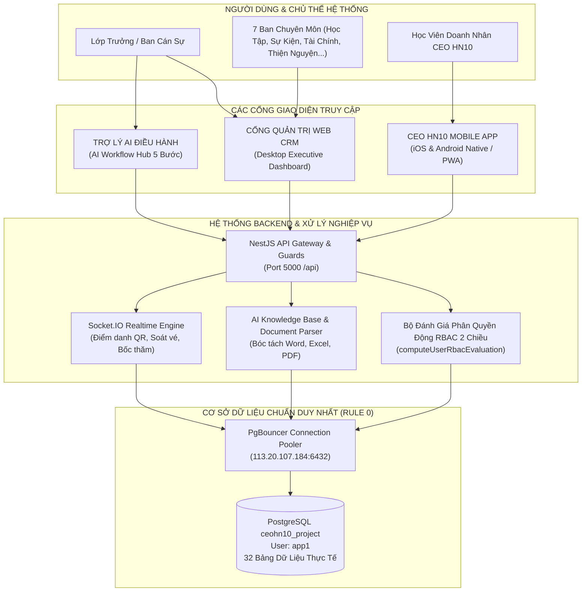
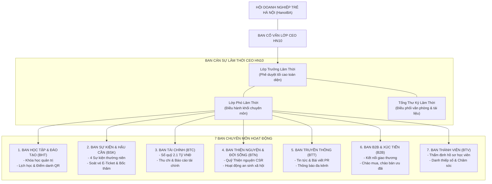
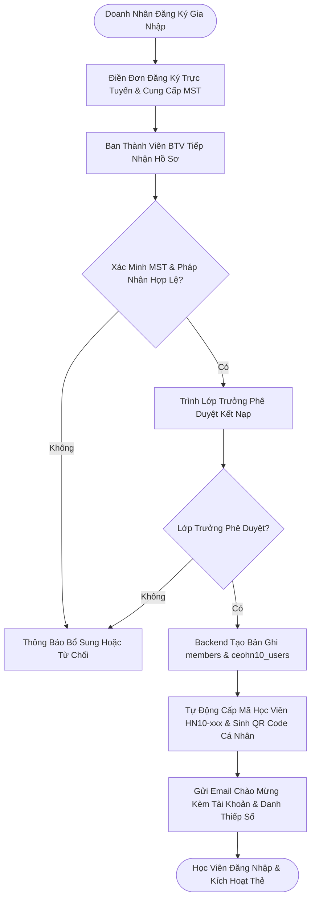
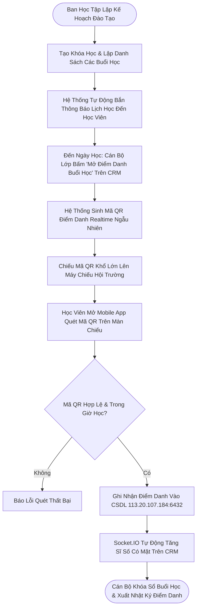
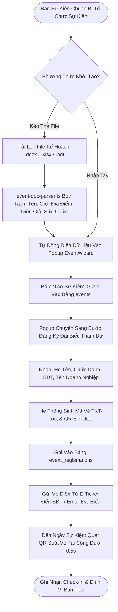

# HỆ SINH THÁI SỐ HÓA & QUẢN TRỊ HIỆP HỘI DOANH NHÂN CEO HN10 (HANOIBA)
## TÀI LIỆU YÊU CẦU NGHIỆP VỤ TỔNG THỂ CHÍNH THỨC
*(BUSINESS REQUIREMENTS DOCUMENT - MASTER BRD - ENTERPRISE V10.0)*

---

* **Mã tài liệu:** `BRD-CEOHN10-MASTER-CHINH-THUC`
* **Phiên bản:** `Phiên bản 10.0 Toàn Diện (Bản Bàn Giao Ban Lãnh Đạo, Ban Cán Sự & Doanh Nghiệp Thành Viên)`
* **Cơ quan chủ quản:** Câu Lạc Bộ Doanh Nhân CEO HN10 — Trực thuộc Hội Doanh Nghiệp Trẻ Hà Nội (HanoiBA)
* **Đơn vị phát triển giải pháp:** VICONNECT - Nền tảng Chuyển Đổi Số Hiệp Hội Doanh Nhân
* **Cơ sở dữ liệu trung tâm:** PostgreSQL `113.20.107.184:6432` (ceohn10_project) qua PgBouncer
* **Cấp độ bảo mật:** Lưu hành nội bộ Ban Lãnh Đạo, Ban Cán Sự & Học viên Doanh nhân CEO HN10
* **Thời điểm ban hành:** Tháng 11/2026

---

## MỤC LỤC TỔNG THỂ
1. **CHƯƠNG 1: TỔNG QUAN, BỐI CẢNH VẬN HÀNH & MỤC TIÊU CHIẾN LƯỢC**
   - 1.1. Bối cảnh thành lập & Sứ mệnh kết nối doanh nhân CEO HN10
   - 1.2. Thách thức thực tế trước khi chuyển đổi số (Pain Points)
   - 1.3. Mục tiêu chiến lược & Chỉ số đo lường hiệu quả (Strategic KPIs)
   - 1.4. Sơ đồ kiến trúc tổng thể Hệ sinh thái VOA CEO HN10 (Mermaid Diagram)
2. **CHƯƠNG 2: CƠ CẤU TỔ CHỨC & PHÂN ĐỊNH TRÁCH NHIỆM 7 BAN CHUYÊN MÔN**
   - 2.1. Sơ đồ cơ cấu tổ chức Ban Cố Vấn, Ban Cán Sự & 7 Ban Chuyên Môn (Mermaid Diagram)
   - 2.2. Ma trận chức năng, thẩm quyền & quy chế hoạt động của từng ban
3. **CHƯƠNG 3: HỆ THỐNG SƠ ĐỒ QUY TRÌNH NGHIỆP VỤ KINH DOANH CHI TIẾT (11 BUSINESS FLOWCHARTS)**
   - 3.1. Quy trình Thẩm định, Phê duyệt & Cấp Thẻ Doanh Nhân Số QR
   - 3.2. Quy trình Quản lý Lớp học, Lịch học & Điểm danh QR Realtime
   - 3.3. Quy trình Tổ chức Sự kiện, Import bóc tách file Word/Excel/PDF & Đăng ký đại biểu
   - 3.4. Quy trình Bốc thăm trúng thưởng & Biểu quyết điện tử tại Sự kiện / Gala
   - 3.5. Quy trình Vận động Nhà tài trợ & Phân bổ 4 Nguồn Quỹ (Không dùng gói cố định)
   - 3.6. Quy trình Quản lý Tài chính Thu - Chi 4 Cấp, Sổ Quỹ 2.1 Tỷ VNĐ & Xuất Báo cáo
   - 3.7. Quy trình Thiết lập Biểu mẫu (Templates) cấu hình định dạng Excel, Word, PDF động
   - 3.8. Quy trình Điều hành Cuộc họp, Biên bản nghị quyết & Kho Lưu trữ học liệu
   - 3.9. Quy trình Sàn giao thương B2B & Kết nối hợp tác doanh nghiệp nội khối
   - 3.10. Quy trình Phân quyền Động RBAC 2 chiều & Phân quyền Trợ lý AI (8 năng lực)
   - 3.11. Quy trình Trợ lý AI thực thi tác vụ 5 bước (Bóc tách -> Soạn thảo -> Chọn người nhận -> Xem trước -> Phê duyệt)
4. **CHƯƠNG 4: MA TRẬN YÊU CẦU NGHIỆP VỤ & 30 BUSINESS USE CASES (BUC)**
   - 4.1. Nhóm 15 Use Cases Cổng Quản Trị Web CRM (`BUC-CRM-001` đến `BUC-CRM-015`)
   - 4.2. Nhóm 15 Use Cases Mobile App Học Viên (`BUC-APP-001` đến `BUC-APP-015`)
5. **CHƯƠNG 5: TIÊU CHÍ NGHIỆM THU NGHIỆP VỤ (BUSINESS ACCEPTANCE CRITERIA)**

---

## CHƯƠNG 1: TỔNG QUAN, BỐI CẢNH VẬN HÀNH & MỤC TIÊU CHIẾN LƯỢC

### 1.1. Bối cảnh thành lập & Sứ mệnh kết nối doanh nhân CEO HN10
Câu lạc bộ Doanh nhân CEO HN10 là tổ chức thành viên trực thuộc Hội Doanh Nghiệp Trẻ Hà Nội (HanoiBA). Đây là nơi hội tụ các Chủ tịch Hội đồng Quản trị, Tổng Giám đốc, Nhà sáng lập và Lãnh đạo cấp cao của các doanh nghiệp tư nhân tiêu biểu thuộc lớp CEO HN10 trên địa bàn Thủ đô Hà Nội.

Với phương châm **"Gắn kết sức mạnh — Nâng tầm doanh nhân"**, CLB Doanh nhân CEO HN10 hướng tới mục tiêu:
1. Xây dựng khối liên minh kinh tế nội bộ vững chắc, ưu tiên tiêu dùng và hợp tác thương mại chéo giữa các doanh nghiệp thành viên.
2. Chuẩn hóa công tác quản trị và đào tạo lãnh đạo doanh nghiệp thông qua các khóa học thực chiến.
3. Tổ chức các hoạt động an sinh xã hội, thiện nguyện vì cộng đồng (CSR) thể hiện trách nhiệm của đội ngũ doanh nhân Thủ đô.

---

### 1.2. Thách thức thực tế trước khi chuyển đổi số (Pain Points)
- **PP-01: Dữ liệu học viên phân tán**: Hồ sơ doanh nghiệp và học viên lưu rời rạc trên nhiều file Excel cá nhân, gây thất lạc thông tin khi doanh nghiệp thay đổi trụ sở hoặc người đại diện.
- **PP-02: Quy trình quản lý thu - chi thủ công**: Hội phí và các khoản tài trợ theo dõi thủ công qua sao kê ngân hàng, không phân định minh bạch giữa Quỹ hoạt động và Quỹ thiện nguyện CSR.
- **PP-03: Ùn tắc soát vé sự kiện & nhầm lẫn sơ đồ bàn tiệc**: Tại các sự kiện Gala lớn từ 300 - 600 khách, việc tìm tên trên danh sách giấy mất 30 - 45 phút, gây ùn tắc tại sảnh đón tiếp.
- **PP-04: Thiếu công cụ biểu quyết và bốc thăm minh bạch**: Biểu quyết và bầu cử Ban Cán Sự bằng giấy tốn nhiều thời gian kiểm phiếu, thiếu tính tức thời.
- **PP-05: Khó khăn trong bóc tách văn bản và lập báo cáo**: Ban thư ký và ban tổ chức sự kiện mất nhiều giờ nhập liệu thủ công từ các file Word/Excel kế hoạch chương trình vào phần mềm quản lý.

---

### 1.3. Mục tiêu chiến lược & Chỉ số đo lường hiệu quả (Strategic KPIs)
1. **Số hóa 100% Hồ sơ Học viên**: Cấp mã định danh điện tử (`HN10-xxx`) và danh thiếp số thông minh tích hợp mã QR cá nhân cho toàn bộ học viên.
2. **Quản trị minh bạch Sổ Quỹ Hội 2.1 Tỷ VNĐ**: Tự động hạch toán thu chi, hỗ trợ luồng duyệt 4 cấp và xuất báo cáo tài chính đa định dạng (Excel, Word, PDF) áp dụng mẫu biểu mẫu động.
3. **Soát vé QR E-Ticket dưới 0.5 giây/đại biểu**: Tự động sinh mã vé QR ngay khi đăng ký, quét mã check-in thời gian thực, triệt tiêu 100% vé trùng lặp.
4. **Điểm danh buổi học realtime 1 chạm**: Chiếu mã QR buổi học lên màn chiếu để học viên quét trên Mobile App, tự động cập nhật sĩ số có mặt.
5. **Trợ lý AI hỗ trợ tự động hóa nghiệp vụ**: Tự động bóc tách file Word/Excel kế hoạch sự kiện và thông báo nộp phí, hỗ trợ quy trình 5 bước phê duyệt thông minh.

---

### 1.4. Sơ đồ kiến trúc tổng thể Hệ sinh thái VOA CEO HN10



---

## CHƯƠNG 2: CƠ CẤU TỔ CHỨC & PHÂN ĐỊNH TRÁCH NHIỆM 7 BAN CHUYÊN MÔN

### 2.1. Sơ đồ cơ cấu tổ chức Ban Cố Vấn, Ban Cán Sự & 7 Ban Chuyên Môn



### 2.2. Ma trận chức năng, thẩm quyền & quy chế hoạt động của từng ban

| Mã Ban | Tên Ban Chuyên Môn | Vai Trò & Thẩm Quyền Nghiệp Vụ Cốt Lõi |
| :---: | :--- | :--- |
| **BDH** | **Ban Cán Sự (BCS)** | Lãnh đạo chung, phê duyệt kế hoạch tài chính, duyệt chi ngân sách lớn, quyết định bổ nhiệm nhân sự và kết nạp thành viên. |
| **BHT** | **Ban Học Tập & Đào Tạo** | Xây dựng chương trình giảng dạy, mời giảng viên chuyên gia, thiết lập lịch buổi học, kiểm soát mã QR điểm danh realtime và tài liệu bài giảng. |
| **BSK** | **Ban Sự Kiện & Hậu Cần** | Tổ chức 4 sự kiện cố định thường niên (15/03, 18/07, 26/12, 16/01), bóc tách kế hoạch sự kiện từ file Word/Excel, soát vé E-Ticket và điều khiển bốc thăm may mắn. |
| **BTC** | **Ban Tài Chính** | Quản lý minh bạch Sổ Quỹ Hội 2.1 Tỷ VNĐ, theo dõi các khoản thu chi, lập phiếu thu/chi, đối soát chứng từ và xuất báo cáo tài chính đa định dạng. |
| **BTN** | **Ban Thiện Nguyện & Đời Sống**| Vận động và điều phối Quỹ Thiện Nguyện CSR (tiền mặt & hiện vật), tổ chức các chương trình tương thân tương ái, chăm lo đời sống học viên. |
| **BTT** | **Ban Truyền Thông** | Quản lý tin tức bài viết, truyền thông thương hiệu lớp CEO HN10, phát hành thông báo sự kiện/lớp học qua email và thông báo đẩy. |
| **B2B** | **Ban B2B & Xúc Tiến Thương Mại**| Điều phối sàn giao thương B2B nội khối, thúc đẩy hợp tác tiêu dùng chéo giữa các doanh nghiệp học viên với chính sách chiết khấu ưu đãi. |
| **BTV** | **Ban Thành Viên** | Thẩm định tư cách pháp nhân doanh nghiệp, quản lý hồ sơ học viên 360 độ, theo dõi tình trạng sinh hoạt và gia hạn niên liễm. |

---

## CHƯƠNG 3: HỆ THỐNG SƠ ĐỒ QUY TRÌNH NGHIỆP VỤ KINH DOANH CHI TIẾT (11 FLOWCHARTS)

### 3.1. Quy trình Thẩm định, Phê duyệt & Cấp Thẻ Doanh Nhân Số QR



---

### 3.2. Quy trình Quản lý Lớp học, Lịch học & Điểm danh QR Realtime



---

### 3.3. Quy trình Tổ chức Sự kiện, Import bóc tách file Word/Excel/PDF & Đăng ký đại biểu



---

### 3.4. Quy trình Bốc thăm trúng thưởng & Biểu quyết điện tử tại Sự kiện / Gala

```mermaid
flowchart TD
    Start([Khai Mạc Phần Hội Gala / Đại Hội]) --> Split{Loại Tác Vụ?}
    
    Split -- Bốc Thăm May Mắn --> StepLD1[Thiết Lập Cơ Cấu Giải Thưởng (Đặc Biệt, Nhất, Nhì...)]
    StepLD1 --> StepLD2[Lọc Danh Sách Đại Biểu Đã Check-in Thực Tế Tại Sự Kiện]
    StepLD2 --> StepLD3[Bấm 'Quay Số May Mắn' -> Hiệu Ứng Trống & Vòng Xoay 3D]
    StepLD3 --> StepLD4[Hiển Thị Họ Tên & Doanh Nghiệp Người Trúng Giải Lên Màn Hình Lớn]
    StepLD4 --> StepLD5[Ghi Nhận Lịch Sử Vào lucky_draw_history & Trao Quà]
    
    Split -- Biểu Quyết Bầu Cử --> StepVote1[Ban Cán Sự Mở Phiên Biểu Quyết Trên CRM]
    StepVote1 --> StepVote2[Màn Hình Mobile App Học Viên Hiện Popup Biểu Quyết]
    StepVote2 --> StepVote3[Đại Biểu Bấm Chọn: Tán Thành / Không Tán Thành / Ý Kiến Khác]
    StepVote3 --> StepVote4[Hệ Thống Kiểm Soát Ràng Buộc: 1 Người - 1 Phiếu Duy Nhất]
    StepVote4 --> StepVote5[CRM Hiển Thị Biểu Đồ Tỷ Lệ Phiếu Realtime Sau Khi Đóng Phiên]
    
    StepLD5 --> End([Hoàn Tất Nghiệp Vụ])
    StepVote5 --> End
```

---

### 3.5. Quy trình Vận động Nhà tài trợ & Phân bổ 4 Nguồn Quỹ (Không dùng gói cố định)

```mermaid
flowchart TD
    Start([Tiếp Nhận Cam Kết Tài Trợ]) --> Step1[Mở Màn Hình Khai Báo Nhà Tài Trợ]
    Step1 --> Step2[Nhập Tên Nhà Tài Trợ & Ô Textarea Mở Rộng Điền Nội Dung]
    Step2 --> Step3[BẮT BUỘC CHỌN 1 TRONG 4 NGUỒN QUỸ TÀI TRỢ]
    
    Step3 --> Branch{Phân Loại Nguồn Quỹ?}
    
    Branch -- Quỹ Hoạt Động · Tiền Mặt --> Fund1[Cộng Vào Quỹ Hoạt Động (Mục Tiền Mặt) -> Sinh Phiếu Thu]
    Branch -- Quỹ Hoạt Động · Hiện Vật --> Fund2[Khai Báo Danh Mục Hiện Vật, Số Lượng & Giá Trị Quy Đổi VNĐ]
    Branch -- Quỹ Thiện Nguyện · Tiền Mặt --> Fund3[Cộng Vào Quỹ Thiện Nguyện CSR (Mục Tiền Mặt)]
    Branch -- Quỹ Thiện Nguyện · Hiện Vật --> Fund4[Khai Báo Vật Phẩm Từ Thiện (Áo Ấm, Quà Tặng CSR) & Nơi Lưu Kho]
    
    Fund1 --> SaveDB[Lưu Trực Tiếp Vào Bảng sponsors & sponsor_items]
    Fund2 --> SaveDB
    Fund3 --> SaveDB
    Fund4 --> SaveDB
    
    SaveDB --> Report[Giao Diện sponsors.tsx & Báo Cáo Phân Tách Rạch Ròi 2 Khối Quỹ]
    Report --> End([Xuất Thư Tri Ân & Vinh Danh Nhà Tài Trợ])
```

---

### 3.6. Quy trình Quản lý Tài chính Thu - Chi 4 Cấp, Sổ Quỹ 2.1 Tỷ VNĐ & Xuất Báo Cáo

```mermaid
flowchart TD
    Start([Phát Sinh Khoản Thu / Khoản Chi]) --> Step1[Kế Toán / Thủ Quỹ Lập Phiếu Trên CRM]
    Step1 --> Step2[Nhập Số Hiệu Chứng Từ, Số Tiền, Diễn Giải & Tải Hóa Đơn]
    Step2 --> Step3[Chọn Danh Mục: Niên Liễm, Sự Kiện, Lớp Học, Thiện Nguyện CSR, Vận Hành]
    
    Step3 --> ApprovalFlow{Quy Trình Duyệt Chi 4 Cấp?}
    
    ApprovalFlow -- Cấp 1 --> DeptCheck[Trưởng Ban Chuyên Môn Xác Nhận Dự Trù]
    DeptCheck --> FinCheck[Trưởng Ban Tài Chính Kiểm Soát Định Mức]
    FinCheck --> LeaderCheck[Lớp Trưởng Lâm Thời Phê Duyệt Cuối]
    
    LeaderCheck --> Decision{Được Duyệt?}
    Decision -- Không --> Reject[Từ Chối Giải Ngân & Trả Về Kèm Lý Do]
    Decision -- Có --> Approve[Cập Nhật approval_status = 'approved']
    
    Approve --> UpdateFund[Tự Động Cập Nhật Số Dư Sổ Quỹ Hội 2.1 Tỷ VNĐ]
    UpdateFund --> ExportChoice[Chọn Xuất Báo Cáo Theo Danh Mục Chi Tiết]
    
    ExportChoice --> ApplyTemplate[Áp Dụng Mẫu Biểu Mẫu Định Dạng Đã Set Up]
    ApplyTemplate --> ExportFile[Xuất File Hoàn Chỉnh: Excel, Word (.docx) hoặc PDF]
    ExportFile --> End([Lưu Vào Lịch Sử finance_reports])
```

---

### 3.7. Quy trình Thiết lập Biểu mẫu (Templates) cấu hình format định dạng Excel, Word, PDF

```mermaid
flowchart TD
    Start([Ban Thư Ký / Kế Toán Vào Phân Hệ Biểu Mẫu /templates]) --> Step1[Chọn Loại Biểu Mẫu: Tài Chính, Sự Kiện, Cuộc Họp, Thiện Nguyện]
    Step1 --> Step2[Cấu Hình Phần Đầu Trang: Tên Hiệp Hội, Địa Chỉ, Quốc Hiệu Tiêu Ngữ, Số Hiệu Văn Bản]
    Step2 --> Step3[Thiết Lập Danh Sách Cột: Đặt Tên Cột, Bật/Tắt Cột, Độ Rộng Cột, Định Dạng Tiền Tệ]
    Step3 --> Step4[Cấu Hình Khối 3 Chữ Ký: Người Lập Biểu, Phụ Trách/Thủ Quỹ, Lớp Trưởng]
    Step4 --> Step5[Bấm 'Lưu Biểu Mẫu' -> Ghi Vào CSDL Bảng templates (Dạng JSONB)]
    Step5 --> Step6[Hệ Thống Tự Động Áp Dụng Cho Toàn Bộ Chức Năng Xuất Báo Cáo Không Hardcode]
    Step6 --> End([Mọi Thay Đổi Format Chỉ Cần Chỉnh Tại Biểu Mẫu, Không Cần Sửa Code])
```

---

### 3.8. Quy trình Điều hành Cuộc họp, Biên bản nghị quyết & Kho Lưu trữ học liệu

```mermaid
flowchart TD
    Start([Ban Cán Sự Triệu Tập Cuộc Họp]) --> Step1[Tạo Lịch Họp Trên CRM: Thời Gian, Địa Điểm, Nội Dung Nghị Sự]
    Step1 --> Step2[Chọn Danh Sách Đại Biểu Được Mời (Lớp Trưởng, Lớp Phó, 7 Trưởng Ban)]
    Step2 --> Step3[Hệ Thống Tự Động Bắn Thông Báo Nhắc Lịch Họp Qua Mobile App]
    Step3 --> Step4[Tổ Chức Họp & Thư Ký Soạn Thảo Biên Bản Trực Tiếp]
    Step4 --> Step5[Tải Tệp Biên Bản Đã Ký Lên Phân Hệ Tài Liệu /documents]
    Step5 --> Step6[Phân Quyền Truy Cập: Công Khai Cho Toàn Lớp Hoặc Giới Hạn Ban Cán Sự]
    Step6 --> End([Lưu Vết Lịch Sử Tra Cứu Hoạt Động])
```

---

### 3.9. Quy trình Sàn giao thương B2B & Kết nối hợp tác doanh nghiệp nội khối

```mermaid
flowchart TD
    Start([Học Viên Có Sản Phẩm / Nhu Cầu Hợp Tác]) --> Step1[Mở Phân Hệ Giao Thương B2B Trên App]
    Step1 --> Step2[Đăng Tin: Chào Bán Ưu Đãi (Offer) Hoặc Tìm Đối Tác (Demand)]
    Step2 --> Step3[Điền Mức Chiết Khấu Đặc Quyền Dành Cho Lớp CEO HN10 (VD: 20% - 30%)]
    Step3 --> Step4[Ban B2B Duyệt Nội Dung & Bài Đăng Hiển Thị Lên Bảng Tin]
    Step4 --> Step5[Doanh Nghiệp Quan Tâm Bấm 'Kết Nối & Nhắn Tin 1-on-1' Trực Tiếp]
    Step5 --> Step6[Hai Bên Thống Nhất Giao Dịch & Ghi Nhận Giá Trị Hợp Tác B2B Nội Khối]
    Step6 --> End([Cộng Dồn Vào Chỉ Số Doanh Số Giao Thương Toàn Lớp])
```

---

### 3.10. Quy trình Phân quyền Động RBAC 2 chiều & Phân quyền Trợ lý AI

```mermaid
flowchart TD
    Start([Admin Vào Quản Lý Phân Quyền /permissions]) --> TabSelect{Chọn Tab Quản Trị?}
    
    TabSelect -- Tab 1: Phân Quyền CRM --> CRMGrid[Ma Trận 9 Nhóm Chức Năng x 7 Vai Trò]
    TabSelect -- Tab 2: Phân Quyền Mobile App --> AppGrid[Ma Trận Tính Năng App x Vai Trò]
    TabSelect -- Tab 3: Phân Quyền Trợ Lý AI --> AIGrid[Ma Trận 8 Năng Lực AI x 7 Vai Trò]
    
    CRMGrid --> EditChecks[Bật/Tắt Checkbox: [Xem], [Thêm], [Sửa], [Xóa]]
    AppGrid --> EditChecks
    AIGrid --> EditAIChecks[Bật/Tắt Năng Lực AI & Gán Cờ Bắt Buộc Duyệt]
    
    EditChecks --> SaveBtn[Bấm 'Lưu Thay Đổi']
    EditAIChecks --> SaveBtn
    
    SaveBtn --> API[Gọi PUT /api/admin/permission-matrix hoặc PUT /api/ai/permissions/matrix]
    API --> SaveDB[Ghi Vào Bảng app_settings (key: crm_permission_matrix, ai_permission_matrix)]
    
    SaveDB --> Eval[Khi User Đăng Nhập: computeUserRbacEvaluation Tính allowedRoutes & permissionsHash]
    Eval --> ClientRender[Sidebar & Nút Chức Năng FE Tự Động Cập Nhật Tức Thì 100% Theo CSDL]
    ClientRender --> End([Hoàn Toàn Không Hardcode Trên Code])
```

---

### 3.11. Quy trình Trợ lý AI thực thi tác vụ 5 bước

```mermaid
flowchart TD
    Start([Người Dùng Vào Trợ Lý AI Điều Hành]) --> Step1[BƯỚC 1: Chọn Tác Vụ (Nhắc Nộp Phí / Báo Cáo / Sự Kiện) & Kéo Thả File Word/Excel]
    Step1 --> ParseAI[AI Tự Động Bóc Tách: Danh Sách Học Viên, Số Tiền, Email, SĐT]
    
    ParseAI --> Step2[BƯỚC 2: Soạn Thảo & Tối Ưu Giọng Văn Doanh Nhân]
    Step2 --> Step3[BƯỚC 3: Chọn Người Nhận (Chọn 1 Người, Chọn Nhiều Người, Hoặc Checkbox 'Chọn Tất Cả')]
    
    Step3 --> Step4[BƯỚC 4: Xem Trước Giao Diện Email / Thông Báo Thực Tế]
    Step4 --> Step5[BƯỚC 5: PHÊ DUYỆT & THỰC THI CUỐI CÙNG]
    
    Step5 --> ExecAction{Lựa Chọn Thao Tác?}
    ExecAction -- Gửi Thông Báo --> SendNotif[Bấm 'Phê Duyệt & Gửi Thông Báo' -> Phát Hành Email & Thông Báo Đẩy]
    ExecAction -- Xuất Báo Cáo --> ExportDocs[Bấm 'Duyệt & Xuất File' -> Tạo File Tự Động: Excel, Word, PDF Theo Biểu Mẫu]
    
    SendNotif --> End([Ghi Nhận Lịch Sử Vào Audit Log])
    ExportDocs --> End
```

---

## CHƯƠNG 4: MA TRẬN YÊU CẦU NGHIỆP VỤ & 30 BUSINESS USE CASES (BUC)

### 4.1. Nhóm 15 Business Use Cases Quản Trị Hiệp Hội (Web CRM)

| Mã BUC | Tên Nghiệp Vụ Use Case | Nhóm Phân Hệ | Diễn Giải Chi Tiết |
| :---: | :--- | :--- | :--- |
| `BUC-CRM-001` | Quản trị Dashboard Tổng quan & Ví Quỹ | Tổng quan | Theo dõi chỉ số toàn diện: Sĩ số học viên, Sổ quỹ 2.1 Tỷ VNĐ, 4 sự kiện thường niên. |
| `BUC-CRM-002` | Trợ lý AI Điều hành & Workflow 5 Bước | Trợ lý AI | Bóc tách file Word/Excel/PDF, tối ưu copywriting doanh nhân, duyệt gửi thông báo và xuất báo cáo. |
| `BUC-CRM-003` | Quản lý Hồ sơ 360 Độ Học viên | Học viên | Thẩm định, tạo mới, chỉnh sửa thông tin doanh nghiệp, xuất danh bạ học viên. |
| `BUC-CRM-004` | Quản lý Lớp học & Điểm danh QR Realtime| Lớp học | Tạo khóa đào tạo, mở điểm danh buổi học bằng mã QR chiếu hội trường. |
| `BUC-CRM-005` | Tổ chức Sự kiện & Import Bóc tách File | Sự kiện | Kéo thả file kế hoạch tạo sự kiện tự động, đăng ký đại biểu ngay tại popup. |
| `BUC-CRM-006` | Biểu quyết điện tử & Kiểm phiếu Realtime| Sự kiện | Tạo phiên lấy ý kiến đại hội, kiểm soát 1 người - 1 phiếu, xem biểu đồ trực tiếp. |
| `BUC-CRM-007` | Điều khiển Bốc thăm trúng thưởng Gala | Sự kiện | Thiết lập cơ cấu giải thưởng, quay số ngẫu nhiên đại biểu đã check-in. |
| `BUC-CRM-008` | Quản lý Nhà tài trợ & 4 Nguồn Quỹ | Nhà tài trợ | Không dùng gói cứng, tự do điền nội dung, phân loại bắt buộc vào 4 nguồn quỹ. |
| `BUC-CRM-009` | Quản trị Sổ Quỹ Hội 2.1 Tỷ VNĐ & Thu Chi | Tài chính | Lập phiếu thu, phiếu chi, đối soát hóa đơn chứng từ, luồng phê duyệt 4 cấp. |
| `BUC-CRM-010` | Xuất Báo cáo Tài chính Đa Định Dạng | Tài chính | Chọn danh mục xuất (Sự kiện, Lớp học, Phí tham gia, CSR) xuất Word, Excel, PDF. |
| `BUC-CRM-011` | Cấu hình Format Biểu mẫu Động | Biểu mẫu | Tùy biến mẫu báo cáo Word, Excel, PDF (tiêu ngữ, tên cột, 3 chữ ký) không hardcode. |
| `BUC-CRM-012` | Quản lý Cuộc họp & Kho Lưu trữ số | Hoạt động | Lập lịch họp Ban Cán Sự, lưu trữ nghị quyết, quy chế, biên bản và học liệu. |
| `BUC-CRM-013` | Cài đặt hệ thống & Nhật ký an ninh Audit | Hệ thống | Thiết lập thông số, theo dõi lịch sử thao tác của các tài khoản (đã bỏ ví VNPay/MoMo). |
| `BUC-CRM-014` | Quản trị 7 Ban Chuyên Môn & Nhân sự | Phân quyền | Quản lý cơ cấu Ban Cán Sự và 7 Ban (bổ sung Ban Thiện Nguyện BTN). |
| `BUC-CRM-015` | Ma trận Phân quyền Động RBAC & AI | Phân quyền | Điều khiển phân quyền 2 chiều cho CRM, App và 8 Năng lực Trợ Lý AI qua CSDL. |

---

### 4.2. Nhóm 15 Business Use Cases Học Viên Doanh Nhân (Mobile App)

| Mã BUC | Tên Nghiệp Vụ Use Case | Nhóm Phân Hệ | Diễn Giải Chi Tiết |
| :---: | :--- | :--- | :--- |
| `BUC-APP-001` | Đăng nhập an toàn & Xác thực sinh trắc | Tài khoản | Đăng nhập bằng Email/SĐT, hỗ trợ FaceID / Vân tay an toàn tiện lợi. |
| `BUC-APP-002` | Thẻ Doanh Nhân Số & Danh Thiếp QR 1-Chạm | Trang chủ | Chạm để chia sẻ thông tin doanh nghiệp, quét mã kết nối danh bạ ngay tức thì. |
| `BUC-APP-003` | Xem Lịch học & Quét QR Điểm danh Buổi học | Lớp học | Xem thời khóa biểu, tài liệu buổi học, quét mã QR trên máy chiếu để điểm danh. |
| `BUC-APP-004` | Khám phá Sự kiện & Đăng ký Vé E-Ticket | Sự kiện | Xem lịch 4 sự kiện thường niên, đăng ký vé mời điện tử có mã QR soát vé. |
| `BUC-APP-005` | Check-in Vào Cổng Gala Dưới 0.5 Giây | Sự kiện | Đưa mã vé QR E-Ticket cho ban lễ tân quét tại cổng, nhận vị trí bàn tiệc. |
| `BUC-APP-006` | Biểu quyết điện tử trực tuyến | Sự kiện | Tham gia bầu cử Ban Cán Sự và biểu quyết nghị quyết trực tiếp trên điện thoại. |
| `BUC-APP-007` | Tham gia Bốc thăm may mắn Gala | Sự kiện | Tự động có mã số may mắn khi check-in, nhận thông báo trúng giải ngay trên màn hình. |
| `BUC-APP-008` | Đăng bài Giao thương B2B Nội Khối | Kết nối B2B | Niêm yết sản phẩm, dịch vụ với chính sách chiết khấu ưu đãi cho học viên. |
| `BUC-APP-009` | Tìm kiếm Đối tác & Nhắn tin trao đổi | Kết nối B2B | Tìm kiếm doanh nghiệp theo ngành nghề, nhắn tin 1-on-1 bàn bạc cơ hội hợp tác. |
| `BUC-APP-010` | Tra cứu Danh bạ Doanh nhân CEO HN10 | Danh bạ | Tìm kiếm thông tin liên hệ, chức vụ, lĩnh vực hoạt động của các chủ doanh nghiệp. |
| `BUC-APP-011` | Đóng Hội Phí Niên Liễm & Lịch sử Tài chính| Cá nhân | Tra cứu tình trạng nộp hội phí cá nhân, nhận thông báo nhắc nộp từ thủ quỹ. |
| `BUC-APP-012` | Đóng góp Quỹ Thiện Nguyện CSR | Thiện nguyện | Đồng hành cùng Ban Thiện Nguyện trong các hoạt động an sinh xã hội vì cộng đồng. |
| `BUC-APP-013` | Đọc Tin tức & Truyền thông Hiệp hội | Truyền thông | Cập nhật tin hoạt động nội bộ, bài viết vinh danh doanh nhân tiêu biểu. |
| `BUC-APP-014` | Khám phá Đặc quyền Quyền lợi & Ưu đãi | Ưu đãi | Sử dụng các voucher ưu đãi độc quyền từ các đối tác liên kết của CLB. |
| `BUC-APP-015` | Tra cứu Văn bản, Quy chế & Kho Học liệu | Tài liệu | Tải và xem nghị quyết đại hội, slide bài giảng đào tạo mọi lúc mọi nơi. |

---

## CHƯƠNG 5: TIÊU CHÍ NGHIỆM THU NGHIỆP VỤ (BUSINESS ACCEPTANCE CRITERIA)

1. **Tuân thủ Cơ Sở Dữ Liệu Tối Cao (Rule 0)**: Toàn bộ dữ liệu ghi nhận và hiển thị bắt buộc lưu tại PostgreSQL `113.20.107.184:6432/ceohn10_project`. Tuyệt đối không hardcode, không dùng dữ liệu mock/fake che giấu lỗi.
2. **Đồng bộ Ma Trận Phân Quyền 2 Chiều**: Khi thay đổi checkbox quyền trên CRM (`/permissions`), dữ liệu ghi vào CSDL và tự động áp dụng ngay cho quyền truy cập route của người dùng khi đăng nhập mà không cần sửa code.
3. **Phân Quyền Trợ Lý AI Chặt Chẽ**: Trợ lý AI có 8 năng lực rõ ràng, các hành động gửi email nhắc nộp phí hoặc gửi thông báo sự kiện bắt buộc phải qua bước xem trước và phê duyệt cuối cùng (Approval Gate).
4. **Không Dùng Gói Tài Trợ Cứng**: Phân hệ nhà tài trợ cho phép nhập nội dung mở rộng và phân bổ chính xác vào 4 nguồn quỹ (Quỹ hoạt động tiền/hiện vật, Quỹ thiện nguyện tiền/hiện vật).
5. **Định Dạng Biểu Mẫu Linh Hoạt**: Báo cáo tài chính xuất ra các định dạng Word, Excel, PDF áp dụng đúng cấu hình đã thiết lập tại phân hệ Biểu mẫu (`/templates`).
