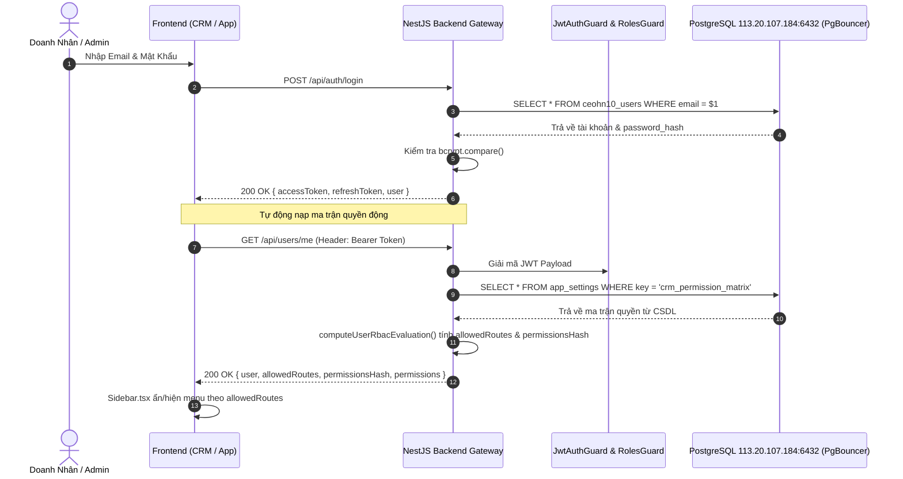
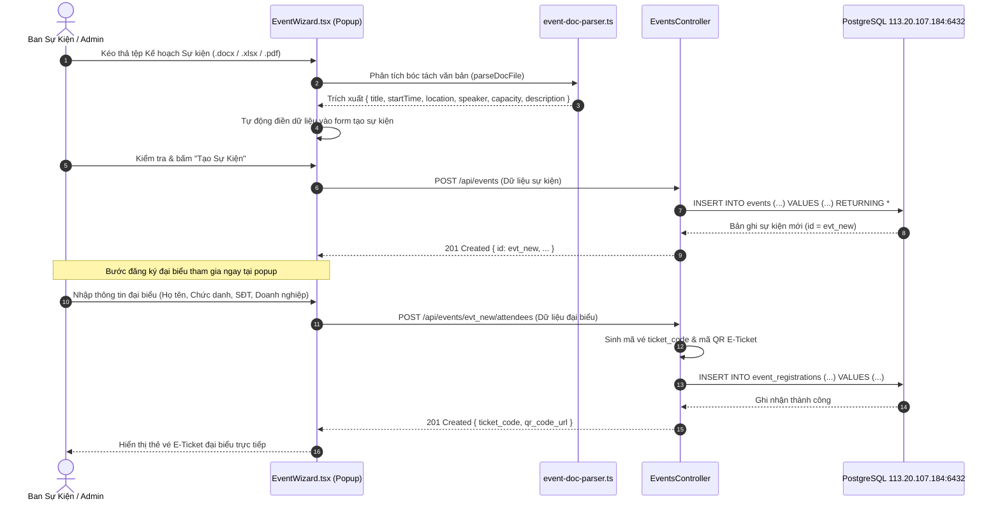
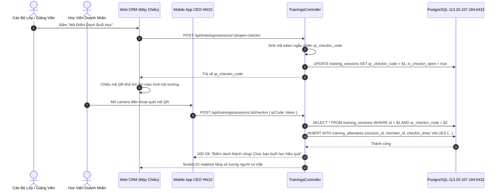
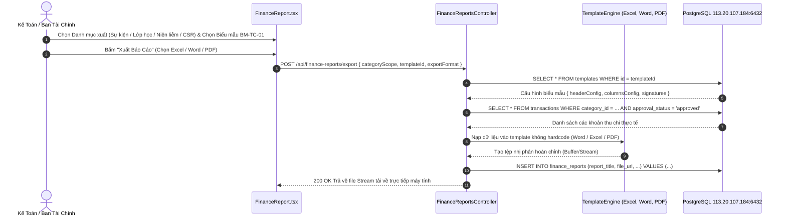
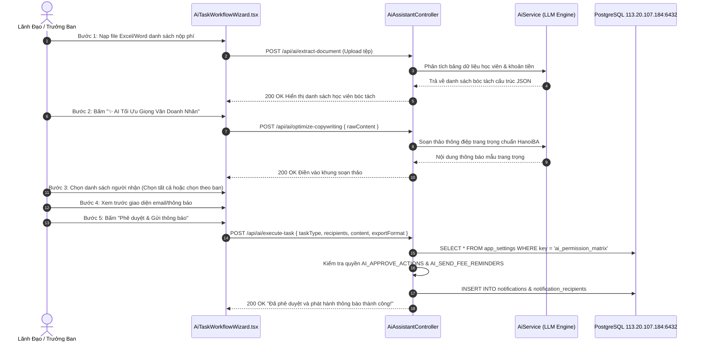

# ĐẶC TẢ GIAO DIỆN LẬP TRÌNH RESTFUL API HỆ THỐNG CEO HN10 (HANOIBA)
## RESTFUL API DESIGN SPECIFICATION - ENTERPRISE EDITION
*Mã tài liệu: API-CEOHN10-ENTERPRISE-V2.0*  
*Đơn vị chủ quản: CLB Doanh Nhân CEO HN10 — Trực thuộc Hội Doanh Nghiệp Trẻ Hà Nội (HanoiBA)*  
*Cơ sở dữ liệu trung tâm: PostgreSQL 113.20.107.184:6432 (Database: ceohn10_project)*  
*Phiên bản kiến trúc: Dynamic Bidirectional RBAC & Clean 3-Tier NestJS*  
*Thời điểm ban hành: Tháng 11/2026*  

---

## MỤC LỤC TỔNG THỂ
1. **NGUYÊN TẮC THIẾT KẾ & TIÊU CHUẨN RESTFUL API**
   - 1.1. Base URLs & Cấu trúc tiền tố định tuyến
   - 1.2. Mã trạng thái HTTP tiêu chuẩn (HTTP Status Codes)
   - 1.3. Cấu trúc đóng gói phản hồi chuẩn hóa (Standard Response Envelope)
   - 1.4. Chuẩn báo lỗi chi tiết RFC 7807 (Problem Details for HTTP APIs)
   - 1.5. Cơ chế xác thực Bearer Token (JWT) & Phân quyền RBAC Guards
2. **SƠ ĐỒ TRÌNH TỰ XỬ LÝ API TỔNG THỂ (MERMAID SEQUENCE DIAGRAMS)**
   - 2.1. Sơ đồ xử lý xác thực và phân quyền RBAC 2 chiều
   - 2.2. Sơ đồ tạo sự kiện kết hợp import bóc tách file Word/Excel/PDF & đăng ký đại biểu
   - 2.3. Sơ đồ điểm danh lớp học bằng mã QR Realtime trên Mobile App
   - 2.4. Sơ đồ xuất báo cáo tài chính đa định dạng áp dụng mẫu Biểu mẫu động
   - 2.5. Sơ đồ Trợ lý AI thực thi tác vụ 5 bước (Bóc tách -> Soạn thảo -> Chọn người nhận -> Duyệt -> Gửi)
3. **ĐẶC TẢ CHI TIẾT CÁC PHÂN HỆ API (ĐẦY ĐỦ CÁC PHƯƠNG THỨC GET, POST, PUT, PATCH, DELETE)**
   - 3.1. Phân hệ 1: Xác thực, Phiên & Hồ sơ cá nhân (`/api/auth/*`, `/api/users/*`)
   - 3.2. Phân hệ 2: Quản lý Học viên & Doanh nghiệp (`/api/members/*`, `/api/companies/*`)
   - 3.3. Phân hệ 3: Cơ cấu 7 Ban Chuyên Môn & Nhân sự (`/api/departments/*`)
   - 3.4. Phân hệ 4: Lớp học, Buổi học & Điểm danh QR Realtime (`/api/trainings/*`, `/api/training-sessions/*`)
   - 3.5. Phân hệ 5: Sự kiện, Bóc tách file, Đăng ký tham dự, Biểu quyết & Bốc thăm (`/api/events/*`, `/api/voting/*`, `/api/lucky-draw/*`)
   - 3.6. Phân hệ 6: Nhà tài trợ & Quỹ tài trợ 4 nguồn (`/api/sponsors/*`)
   - 3.7. Phân hệ 7: Tài chính Thu - Chi, Sổ quỹ 2.1 Tỷ & Xuất báo cáo (`/api/transactions/*`, `/api/finance-reports/*`)
   - 3.8. Phân hệ 8: Biểu mẫu cấu hình format Excel, Word, PDF (`/api/templates/*`)
   - 3.9. Phân hệ 9: Quản lý Cuộc họp & Kho Tài liệu học liệu (`/api/meetings/*`, `/api/documents/*`)
   - 3.10. Phân hệ 10: Cơ hội giao thương B2B & Tin nhắn nội bộ (`/api/b2b/*`, `/api/messages/*`)
   - 3.11. Phân hệ 11: Thông báo, Tin tức bài viết & Quyền lợi (`/api/notifications/*`, `/api/news/*`, `/api/perks/*`)
   - 3.12. Phân hệ 12: Cài đặt hệ thống, Nhật ký an ninh & Phân quyền RBAC (`/api/settings/*`, `/api/activities/*`, `/api/admin/permission-matrix`, `/api/permissions/*`)
   - 3.13. Phân hệ 13: Trợ lý AI, Nạp hồ sơ BRD/SRS/DB/API & Phân quyền Trợ lý AI (`/api/ai/*`)

---

## 1. NGUYÊN TẮC THIẾT KẾ & TIÊU CHUẨN RESTFUL API

### 1.1. Base URLs & Cấu trúc tiền tố định tuyến
- **Môi trường phát triển nội bộ**: `http://113.20.107.184:5000/api` hoặc `http://localhost:5000/api`
- **Môi trường sản xuất chính thức**: `https://api-ceohn10.viconnect.vn/api`
- Toàn bộ các API đều bắt buộc có tiền tố chung: `/api`.

### 1.2. Mã trạng thái HTTP tiêu chuẩn (HTTP Status Codes)
| HTTP Code | Ý Nghĩa Kỹ Thuật | Tình Huống Áp Dụng |
| :---: | :--- | :--- |
| `200 OK` | Yêu cầu thành công | Các phương thức GET, PUT, PATCH trả về dữ liệu payload |
| `201 Created` | Bản ghi được tạo mới | Phương thức POST thêm mới thành công vào PostgreSQL `113.20.107.184:6432` |
| `204 No Content` | Thành công không nội dung | Phương thức DELETE khi xóa bản ghi thành công |
| `400 Bad Request` | Yêu cầu không hợp lệ | Thiếu trường bắt buộc, sai định dạng dữ liệu (Validation Failed) |
| `401 Unauthorized` | Chưa xác thực | Không truyền Bearer Token hoặc token JWT đã hết hạn / không hợp lệ |
| `403 Forbidden` | Không đủ thẩm quyền | Bị chặn bởi RBAC Guard (Ví dụ: Member gọi API duyệt chi của Lớp Trưởng) |
| `404 Not Found` | Không tìm thấy tài nguyên | ID bản ghi không tồn tại trong CSDL |
| `409 Conflict` | Xung đột dữ liệu | Trùng mã số thuế doanh nghiệp, trùng mã định danh học viên, trùng email |
| `500 Server Error` | Lỗi máy chủ nội bộ | Lỗi xử lý ngoại lệ hoặc ngắt kết nối tạm thời PgBouncer `113.20.107.184:6432` |

### 1.3. Cấu trúc đóng gói phản hồi chuẩn hóa (Standard Response Envelope)
Mọi phản hồi thành công từ Backend NestJS đều được đóng gói theo schema thống nhất:
```json
{
  "statusCode": 200,
  "message": "Thao tác thực hiện thành công",
  "data": {},
  "timestamp": "2026-11-18T13:30:00.000Z"
}
```

### 1.4. Chuẩn báo lỗi chi tiết RFC 7807 (Problem Details for HTTP APIs)
Khi gặp lỗi, API trả về cấu trúc lỗi chuẩn để Client hiển thị thông báo chính xác cho người dùng:
```json
{
  "statusCode": 400,
  "error": "Bad Request",
  "message": [
    "sponsor_fund_type must be one of the following values: general_cash, general_in_kind, charity_cash, charity_in_kind",
    "content should not be empty"
  ],
  "timestamp": "2026-11-18T13:30:00.000Z",
  "path": "/api/sponsors"
}
```

### 1.5. Cơ chế xác thực Bearer Token (JWT) & Phân quyền RBAC Guards
Mọi request đến các endpoint yêu cầu xác thực phải đính kèm Header:
```http
Authorization: Bearer <access_token_jwt>
```
Backend NestJS xác thực qua `JwtAuthGuard` và kiểm tra quyền hạn thao tác qua `RolesGuard` đối chiếu trực tiếp với ma trận `crm_permission_matrix` và `ai_permission_matrix` trong CSDL `113.20.107.184:6432`.

---

## 2. SƠ ĐỒ TRÌNH TỰ XỬ LÝ API TỔNG THỂ (MERMAID SEQUENCE DIAGRAMS)

### 2.1. Sơ đồ xử lý xác thực và nạp phân quyền RBAC 2 chiều


### 2.2. Sơ đồ tạo sự kiện kết hợp import bóc tách file Word/Excel/PDF & đăng ký đại biểu


### 2.3. Sơ đồ điểm danh lớp học bằng mã QR Realtime trên Mobile App


### 2.4. Sơ đồ xuất báo cáo tài chính đa định dạng áp dụng mẫu Biểu mẫu động


### 2.5. Sơ đồ Trợ lý AI thực thi tác vụ 5 bước


---

## 3. ĐẶC TẢ CHI TIẾT CÁC PHÂN HỆ API ENDPOINTS

---

### 3.1. Phân hệ 1: Xác Thực, Phiên & Hồ Sơ Cá Nhân

#### 1. `POST /api/auth/login` — Đăng nhập hệ thống
- **Mục đích**: Xác thực người dùng qua Email/SĐT và mật khẩu bcrypt, cấp cặp JWT token.
- **Quyền yêu cầu**: Công khai (Public).
- **Request Body**:
  | Tên Trường | Kiểu Dữ Liệu | Bắt Buộc | Mô Tả | Ví Dụ |
  | :--- | :--- | :---: | :--- | :--- |
  | `email` | `string` | Có | Email đăng nhập | `"admin@ceohn10.vn"` |
  | `password` | `string` | Có | Mật khẩu tài khoản | `"MatKhauBaoMat@2026"` |
  ```json
  {
    "email": "admin@ceohn10.vn",
    "password": "MatKhauBaoMat@2026"
  }
  ```
- **Response 200 OK**:
  | Tên Trường | Kiểu Dữ Liệu | Mô Tả |
  | :--- | :--- | :--- |
  | `accessToken` | `string` | Chuỗi JWT Token truy cập (hạn 1 ngày) |
  | `refreshToken`| `string` | Chuỗi Token làm mới phiên (hạn 30 ngày) |
  | `user` | `object` | Thông tin tài khoản đăng nhập |
  ```json
  {
    "statusCode": 200,
    "message": "Đăng nhập thành công",
    "data": {
      "accessToken": "eyJhbGciOiJIUzI1NiIsInR5cCI6IkpXVCJ9...",
      "refreshToken": "d8a1f8b2-3c4e-4f5a-9b1c-7e8f9a0b1c2d",
      "user": {
        "id": "c1a2b3c4-d5e6-7f8a-9b0c-1d2e3f4a5b6c",
        "email": "admin@ceohn10.vn",
        "fullName": "Nguyễn Văn Chủ Tịch",
        "role": "chu_tich",
        "status": "active"
      }
    }
  }
  ```

#### 2. `GET /api/users/me` — Nạp hồ sơ cá nhân & Quyền hạn RBAC
- **Mục đích**: Lấy thông tin tài khoản hiện tại, hồ sơ học viên, và tính toán toàn bộ quyền hạn RBAC 2 chiều từ CSDL `113.20.107.184:6432`.
- **Headers**: `Authorization: Bearer <token>`
- **Response 200 OK**:
  ```json
  {
    "statusCode": 200,
    "data": {
      "user": {
        "id": "c1a2b3c4-d5e6-7f8a-9b0c-1d2e3f4a5b6c",
        "email": "admin@ceohn10.vn",
        "fullName": "Nguyễn Văn Chủ Tịch",
        "role": "chu_tich",
        "avatarUrl": "https://cdn.ceohn10.vn/avatars/user1.jpg"
      },
      "member": {
        "id": "m1111111-2222-3333-4444-555555555555",
        "memberCode": "HN10-001",
        "position": "Chủ tịch HĐQT",
        "companyName": "Tập đoàn Công nghệ Alpha",
        "qrCodeUrl": "https://cdn.ceohn10.vn/qr/HN10-001.png"
      },
      "allowedRoutes": ["/", "/ai-assistant", "/members", "/events", "/events-overview", "/voting", "/event-registrations", "/lucky-draw", "/sponsors", "/sponsor-report", "/analytics", "/income", "/expenses", "/finance-report", "/notifications", "/meetings", "/documents", "/templates", "/settings", "/activity", "/departments", "/permissions", "/accounts"],
      "permissionsHash": {
        "/members": true,
        "MEM_VIEW": true,
        "MEM_CREATE": true,
        "MEM_UPDATE": true,
        "MEM_DELETE": true,
        "FIN_VIEW": true,
        "FIN_APPROVE": true
      },
      "permissions": ["MEM_VIEW", "MEM_CREATE", "MEM_UPDATE", "MEM_DELETE", "FIN_VIEW", "FIN_APPROVE"]
    }
  }
  ```

#### 3. `PUT /api/users/me` — Cập nhật hồ sơ cá nhân
- **Mục đích**: Người dùng tự cập nhật thông tin cá nhân.
- **Request Body**:
  | Tên Trường | Kiểu Dữ Liệu | Bắt Buộc | Mô Tả |
  | :--- | :--- | :---: | :--- |
  | `fullName` | `string` | Không | Họ tên đầy đủ |
  | `phone` | `string` | Không | Số điện thoại |
  | `avatarUrl`| `string` | Không | URL ảnh đại diện |
  | `bio` | `string` | Không | Tiểu sử tóm tắt |

#### 4. `PATCH /api/users/me/password` — Đổi mật khẩu
- **Mục đích**: Thay đổi mật khẩu tài khoản đang đăng nhập.
- **Request Body**:
  | Tên Trường | Kiểu Dữ Liệu | Bắt Buộc | Mô Tả |
  | :--- | :--- | :---: | :--- |
  | `currentPassword`| `string` | Có | Mật khẩu hiện tại để xác minh |
  | `newPassword` | `string` | Có | Mật khẩu mới (tối thiểu 8 ký tự) |

---

### 3.2. Phân hệ 2: Quản Lý Học Viên & Doanh Nghiệp

#### 1. `GET /api/members` — Danh sách học viên doanh nhân
- **Query Parameters**:
  | Tên Param | Kiểu Dữ Liệu | Bắt Buộc | Mặc Định | Mô Tả |
  | :--- | :--- | :---: | :---: | :--- |
  | `page` | `integer` | Không | `1` | Trang cần lấy |
  | `limit` | `integer` | Không | `20` | Số lượng bản ghi mỗi trang |
  | `search` | `string` | Không | `""` | Từ khóa tìm kiếm họ tên, mã HV, SĐT, tên công ty |
  | `departmentId`| `uuid` | Không | | Lọc theo ban chuyên môn trực thuộc |
  | `status` | `string` | Không | `'active'` | Trạng thái: `active`, `suspended`, `all` |
- **Response 200 OK**:
  ```json
  {
    "statusCode": 200,
    "data": {
      "items": [
        {
          "id": "m1111111-2222-3333-4444-555555555555",
          "memberCode": "HN10-001",
          "fullName": "Nguyễn Văn Doanh",
          "position": "Tổng Giám Đốc",
          "phone": "0988123456",
          "email": "doanh.nv@vietcorp.vn",
          "company": {
            "id": "c1111111-1111-1111-1111-111111111111",
            "companyName": "Công ty Cổ phần VietCorp",
            "taxCode": "0101234567",
            "industry": "Bất Động Sản"
          },
          "status": "active",
          "joinDate": "2026-01-15"
        }
      ],
      "total": 120,
      "page": 1,
      "limit": 20
    }
  }
  ```

#### 2. `POST /api/members` — Thêm mới học viên
- **Request Body**:
  | Tên Trường | Kiểu Dữ Liệu | Bắt Buộc | Mô Tả |
  | :--- | :--- | :---: | :--- |
  | `fullName` | `string` | Có | Họ và tên học viên |
  | `memberCode` | `string` | Có | Mã học viên duy nhất (VD: `HN10-089`) |
  | `phone` | `string` | Có | Số điện thoại liên hệ |
  | `email` | `string` | Có | Email chính thức |
  | `companyName`| `string` | Có | Tên doanh nghiệp sở hữu |
  | `taxCode` | `string` | Không | Mã số thuế doanh nghiệp |
  | `position` | `string` | Có | Chức danh (Chủ tịch HĐQT, CEO...) |
  | `industry` | `string` | Không | Ngành nghề kinh doanh |
  | `departmentId`| `uuid` | Không | Phân bổ vào ban chuyên môn |
- **Response 201 Created**: Trả về bản ghi học viên mới tạo kèm QR code cá nhân.

#### 3. `PUT /api/members/:id` — Cập nhật toàn bộ hồ sơ học viên
- **Path Variable**: `id` (`uuid`): ID học viên cần sửa.
- **Request Body**: Đầy đủ các trường tương tự `POST /api/members`.

#### 4. `PATCH /api/members/:id/status` — Cập nhật trạng thái học viên
- **Path Variable**: `id` (`uuid`).
- **Request Body**:
  ```json
  { "status": "suspended", "reason": "Tạm dừng sinh hoạt vì lý do công tác" }
  ```

#### 5. `DELETE /api/members/:id` — Xóa học viên
- **Path Variable**: `id` (`uuid`).
- **Response 200 OK / 204 No Content**: Xóa mềm (soft delete) hoặc gỡ bỏ khỏi danh sách.

---

### 3.3. Phân hệ 3: Cơ Cấu 7 Ban Chuyên Môn & Nhân Sự

#### 1. `GET /api/departments` — Danh sách 7 Ban Chuyên Môn
- **Response 200 OK**: Trả về danh sách 7 ban: Ban Học Tập (`BHT`), Ban Sự Kiện (`BSK`), Ban Tài Chính (`BTC`), Ban Thiện Nguyện (`BTN`), Ban Truyền Thông (`BTT`), Ban B2B (`B2B`), Ban Thành Viên (`BTV`) kèm thông tin Trưởng ban và tổng số ủy viên.

#### 2. `POST /api/departments/:id/members` — Phân bổ học viên vào ban
- **Path Variable**: `id` (`uuid`): ID ban chuyên môn.
- **Request Body**:
  ```json
  {
    "memberId": "m1111111-2222-3333-4444-555555555555",
    "roleInDept": "pho_ban"
  }
  ```

#### 3. `DELETE /api/departments/:id/members/:memberId` — Rút học viên khỏi ban
- **Path Variables**: `id` (ID ban), `memberId` (ID học viên).

---

### 3.4. Phân hệ 4: Lớp Học, Buổi Học & Điểm Danh QR Realtime

#### 1. `GET /api/trainings` — Danh sách các lớp học
- **Response 200 OK**: Trả về danh sách lớp học, số lượng buổi học đã diễn ra, tổng số học viên đăng ký.

#### 2. `POST /api/trainings` — Tạo lớp học mới
- **Request Body**:
  | Tên Trường | Kiểu Dữ Liệu | Bắt Buộc | Mô Tả |
  | :--- | :--- | :---: | :--- |
  | `title` | `string` | Có | Tên lớp học đào tạo |
  | `instructorName`| `string` | Có | Tên chuyên gia / giảng viên |
  | `startDate` | `string` (date) | Có | Ngày khai giảng (`"2026-04-01"`) |
  | `endDate` | `string` (date) | Không | Ngày kết thúc |
  | `location` | `string` | Có | Địa điểm tổ chức giảng dạy |

#### 3. `POST /api/trainings/sessions/:id/open-checkin` — Mở cổng điểm danh QR Buổi Học
- **Path Variable**: `id` (`uuid`): ID buổi học cụ thể.
- **Response 200 OK**:
  ```json
  {
    "statusCode": 200,
    "data": {
      "sessionId": "s1111111-2222-3333-4444-555555555555",
      "qrCheckinCode": "CHK-SS05-783921",
      "qrImageUrl": "https://api-ceohn10.viconnect.vn/qr/checkin/CHK-SS05-783921.png",
      "isCheckinOpen": true
    }
  }
  ```

#### 4. `POST /api/trainings/sessions/:id/checkin` — Học viên quét QR điểm danh
- **Headers**: `Authorization: Bearer <token>`
- **Request Body**:
  ```json
  { "qrCode": "CHK-SS05-783921" }
  ```
- **Response 200 OK**: Ghi nhận thời gian điểm danh vào CSDL `113.20.107.184:6432`.

---

### 3.5. Phân hệ 5: Sự Kiện, Bóc Tách File, Đăng Ký Đại Biểu, Biểu Quyết & Bốc Thăm

#### 1. `GET /api/events` — Danh sách sự kiện
- **Query Parameters**: `type` (`fixed`, `charity`, `workshop`, `all`), `status`, `page`, `limit`.

#### 2. `POST /api/events` — Tạo sự kiện mới
- **Request Body**:
  | Tên Trường | Kiểu Dữ Liệu | Bắt Buộc | Mô Tả |
  | :--- | :--- | :---: | :--- |
  | `title` | `string` | Có | Tên sự kiện |
  | `eventType` | `string` | Có | `fixed`, `charity`, `workshop`, `gala`, `networking` |
  | `startTime` | `string` (ISO) | Có | Thời gian bắt đầu (`"2026-07-18T07:00:00.000Z"`) |
  | `endTime` | `string` (ISO) | Không | Thời gian kết thúc |
  | `location` | `string` | Có | Địa điểm tổ chức |
  | `speaker` | `string` | Không | Diễn giả chính |
  | `capacity` | `integer` | Không | Sức chứa tối đa |
  | `description` | `string` | Không | Kịch bản chi tiết |
  | `bannerUrl` | `string` | Không | URL ảnh bìa sự kiện |

#### 3. `POST /api/events/:id/attendees` — Đăng ký đại biểu tham dự sự kiện
- **Mục đích**: Đăng ký đại biểu ngay tại popup tạo sự kiện hoặc từ form đăng ký ngoài.
- **Path Variable**: `id` (`uuid`): ID sự kiện.
- **Request Body**:
  | Tên Trường | Kiểu Dữ Liệu | Bắt Buộc | Mô Tả |
  | :--- | :--- | :---: | :--- |
  | `attendeeName` | `string` | Có | Họ và tên đại biểu |
  | `attendeePhone`| `string` | Có | Số điện thoại đại biểu |
  | `attendeeEmail`| `string` | Không | Email nhận vé điện tử |
  | `companyName` | `string` | Có | Tên doanh nghiệp đại biểu đại diện |
  | `position` | `string` | Có | Chức danh công tác |
  | `memberId` | `uuid` | Không | ID học viên nếu là thành viên chính thức |
  ```json
  {
    "attendeeName": "Trần Thị Mai",
    "attendeePhone": "0912345678",
    "attendeeEmail": "mai.tt@group.vn",
    "companyName": "Công ty TNHH Mai Linh Group",
    "position": "Phó Tổng Giám Đốc"
  }
  ```
- **Response 201 Created**:
  ```json
  {
    "statusCode": 201,
    "message": "Đăng ký tham dự sự kiện thành công",
    "data": {
      "id": "reg-99999999-8888-7777-6666-555555555555",
      "ticketCode": "TKT-SK2026-089",
      "qrCodeUrl": "https://api-ceohn10.viconnect.vn/qr/ticket/TKT-SK2026-089.png",
      "checkinStatus": "not_checked_in"
    }
  }
  ```

#### 4. `POST /api/events/:id/checkin-ticket` — Quét mã QR soát vé cổng
- **Request Body**: `{ "ticketCode": "TKT-SK2026-089" }`
- **Response 200 OK**: Trả về thông tin đại biểu, vị trí bàn tiệc và đánh dấu `checked_in`.

#### 5. `POST /api/lucky-draw/draw` — Quay số bốc thăm may mắn
- **Request Body**: `{ "eventId": "uuid", "prizeId": "uuid" }`
- **Response 200 OK**: Trả về đại biểu trúng giải ngẫu nhiên trong danh sách đã check-in.

#### 6. `POST /api/voting/:id/cast` — Bỏ phiếu biểu quyết trực tuyến
- **Path Variable**: `id` (`uuid`): ID phiên biểu quyết.
- **Request Body**: `{ "choice": "agree" }` (`agree`, `disagree`, `abstain`).

---

### 3.6. Phân hệ 6: Nhà Tài Trợ & Quỹ Tài Trợ 4 Nguồn

*Quy tắc: Không dùng gói tài trợ cố định (Vàng, Bạc, Đồng), mở rộng textarea tự do và phân loại bắt buộc vào 4 nguồn quỹ.*

#### 1. `GET /api/sponsors` — Danh sách nhà tài trợ & Thống kê 4 nguồn quỹ
- **Query Parameters**: `fundType` (`general_cash`, `general_in_kind`, `charity_cash`, `charity_in_kind`, `all`).
- **Response 200 OK**:
  ```json
  {
    "statusCode": 200,
    "data": {
      "summary": {
        "generalCashTotal": 500000000,
        "generalInKindTotal": 250000000,
        "charityCashTotal": 150000000,
        "charityInKindTotal": 80000000
      },
      "sponsors": [
        {
          "id": "sp-001",
          "sponsorName": "Tập đoàn Xây Dựng Nam Thăng Long",
          "sponsorFundType": "charity_cash",
          "content": "Tài trợ chương trình Mái ấm vùng cao do Ban Thiện Nguyện phát động",
          "cashAmount": 100000000,
          "inKindValue": 0,
          "status": "confirmed"
        }
      ]
    }
  }
  ```

#### 2. `POST /api/sponsors` — Khai báo nhà tài trợ mới
- **Request Body**:
  | Tên Trường | Kiểu Dữ Liệu | Bắt Buộc | Mô Tả |
  | :--- | :--- | :---: | :--- |
  | `sponsorName` | `string` | Có | Tên cá nhân / doanh nghiệp tài trợ |
  | `sponsorFundType`| `string` | Có | Bắt buộc 1 trong 4 loại: `general_cash`, `general_in_kind`, `charity_cash`, `charity_in_kind` |
  | `content` | `string` | Có | Nội dung diễn giải cam kết tài trợ |
  | `cashAmount` | `number` | Có (nếu là tiền) | Số tiền mặt đóng góp (VNĐ) |
  | `inKindValue` | `number` | Có (nếu hiện vật)| Giá trị quy đổi hiện vật (VNĐ) |
  | `items` | `array` | Không | Danh sách vật phẩm chi tiết `[{ itemName, unit, quantity, unitPrice }]` |

#### 3. `PUT /api/sponsors/:id` — Cập nhật thông tin nhà tài trợ
- **Path Variable**: `id` (`uuid`).

#### 4. `DELETE /api/sponsors/:id` — Hủy bỏ nhà tài trợ
- **Path Variable**: `id` (`uuid`).

---

### 3.7. Phân hệ 7: Tài Chính Thu - Chi, Sổ Quỹ 2.1 Tỷ VNĐ & Báo Cáo

#### 1. `GET /api/transactions` — Sổ quỹ thu chi toàn lớp
- **Query Parameters**:
  | Tên Param | Kiểu Dữ Liệu | Bắt Buộc | Mô Tả |
  | :--- | :--- | :---: | :--- |
  | `type` | `string` | Không | `thu`, `chi`, `all` |
  | `category` | `string` | Không | `DUES`, `EVENT`, `TRAINING`, `CSR`, `OPERATING` |
  | `approvalStatus`| `string` | Không | `pending`, `approved`, `rejected` |
  | `startDate` | `string` | Không | Từ ngày (`"2026-01-01"`) |
  | `endDate` | `string` | Không | Đến ngày (`"2026-12-31"`) |
- **Response 200 OK**:
  ```json
  {
    "statusCode": 200,
    "data": {
      "totalIncome": 2100000000,
      "totalExpense": 0,
      "currentBalance": 2100000000,
      "items": [
        {
          "id": "t0000000-0000-4000-8000-000000000002",
          "voucherCode": "PT-HN10-INIT-02",
          "transactionType": "thu",
          "categoryName": "Hội phí niên liễm",
          "amount": 2075000000,
          "paymentMethod": "bank_transfer",
          "description": "Nộp quỹ đại hội và kinh phí duy trì hoạt động năm 2026",
          "payerReceiver": "Tập thể Học viên CEO HN10",
          "approvalStatus": "approved",
          "transactedAt": "2026-11-16T09:30:00.000Z"
        }
      ]
    }
  }
  ```

#### 2. `POST /api/transactions` — Lập phiếu thu / phiếu chi mới
- **Request Body**:
  | Tên Trường | Kiểu Dữ Liệu | Bắt Buộc | Mô Tả |
  | :--- | :--- | :---: | :--- |
  | `voucherCode` | `string` | Có | Số hiệu chứng từ (VD: `PC-2026-012`) |
  | `transactionType`| `string` | Có | `thu` hoặc `chi` |
  | `categoryId` | `uuid` | Có | Khóa ngoại danh mục thu chi |
  | `amount` | `number` | Có | Số tiền giao dịch (VNĐ) |
  | `description` | `string` | Có | Diễn giải lý do thu/chi |
  | `payerReceiver` | `string` | Có | Người nộp hoặc người thụ hưởng |
  | `paymentMethod` | `string` | Có | `bank_transfer` hoặc `cash` |
  | `receiptUrl` | `string` | Không | URL hóa đơn/chứng từ |

#### 3. `PATCH /api/transactions/:id/approve` — Phê duyệt khoản chi (4 Cấp)
- **Quyền yêu cầu**: Lớp Trưởng / Trưởng Ban Tài Chính.
- **Request Body**:
  ```json
  {
    "status": "approved",
    "approvalNote": "Đồng ý giải ngân thanh toán hội trường khách sạn JW Marriott"
  }
  ```

#### 4. `POST /api/finance-reports/export` — Xuất báo cáo tài chính đa định dạng
- **Request Body**:
  | Tên Trường | Kiểu Dữ Liệu | Bắt Buộc | Mô Tả |
  | :--- | :--- | :---: | :--- |
  | `categoryScope` | `string` | Có | Danh mục xuất: `all`, `event`, `training`, `dues`, `csr` |
  | `exportFormat` | `string` | Có | Định dạng tệp: `excel`, `word`, `pdf` |
  | `templateId` | `uuid` | Không | Áp dụng cấu hình biểu mẫu format tùy biến |
  | `startDate` | `string` | Không | Ngày bắt đầu kỳ báo cáo |
  | `endDate` | `string` | Không | Ngày kết thúc kỳ báo cáo |
- **Response**: Trả về tệp tin nhị phân tải về (Binary stream: `application/vnd.openxmlformats-officedocument.spreadsheetml.sheet`, `application/vnd.openxmlformats-officedocument.wordprocessingml.document`, hoặc `application/pdf`).

---

### 3.8. Phân hệ 8: Biểu Mẫu Cấu Hình Format Excel, Word, PDF

#### 1. `GET /api/templates` — Danh sách biểu mẫu cấu hình format
- **Response 200 OK**: Trả về danh sách các biểu mẫu báo cáo, danh sách cột, cấu hình tiêu đề và chữ ký.

#### 2. `POST /api/templates` — Tạo biểu mẫu định dạng mới
- **Request Body**:
  | Tên Trường | Kiểu Dữ Liệu | Bắt Buộc | Mô Tả |
  | :--- | :--- | :---: | :--- |
  | `templateCode` | `string` | Có | Mã biểu mẫu (VD: `BM-TC-02`) |
  | `name` | `string` | Có | Tên biểu mẫu |
  | `category` | `string` | Có | `finance`, `event`, `charity` |
  | `headerConfig` | `object` | Có | Tiêu ngữ, tên CLB, số hiệu thông tư |
  | `columnsConfig`| `array` | Có | Danh sách cột cần xuất `[{ colKey, title, width, visible }]` |
  | `signatures` | `array` | Có | Khối 3 chữ ký `[{ title, role, name }]` |

#### 3. `PUT /api/templates/:id` — Chỉnh sửa biểu mẫu định dạng
- **Path Variable**: `id` (`uuid`).

---

### 3.9. Phân hệ 9: Quản Lý Cuộc Họp & Kho Tài Liệu Số

#### 1. `GET /api/meetings` — Danh sách cuộc họp Ban Cán Sự & Các Ban
- **Query Parameters**: `departmentId`, `status`.

#### 2. `POST /api/meetings` — Tạo lịch họp mới
- **Request Body**:
  ```json
  {
    "title": "Họp Ban Cán Sự rà soát tiến độ Đại hội nhiệm kỳ 2026-2029",
    "meetingDate": "2026-11-25",
    "startTime": "14:00",
    "location": "Phòng họp Ban Thường Trực - Trụ sở HanoiBA",
    "agenda": "1. Báo cáo tài chính; 2. Danh sách đại biểu; 3. Kịch bản Gala",
    "attendeeMemberIds": ["m111...", "m222..."]
  }
  ```

#### 3. `POST /api/documents/upload` — Tải lên tài liệu, nghị quyết, biên bản
- **Content-Type**: `multipart/form-data`
- **Form Fields**: `file` (Binary), `title` (`string`), `departmentId` (`uuid`), `docType` (`string`).

---

### 3.10. Phân hệ 10: Cơ Hội Giao Thương B2B & Tin Nhắn

#### 1. `GET /api/b2b` — Danh sách cơ hội giao thương B2B
- **Query Parameters**: `type` (`offer`, `demand`, `all`), `search`.

#### 2. `POST /api/b2b` — Đăng bài giao thương nội bộ
- **Request Body**:
  ```json
  {
    "type": "offer",
    "title": "Cung cấp giải pháp phần mềm quản trị doanh nghiệp chiết khấu 25%",
    "description": "Dành riêng cho doanh nghiệp thành viên CEO HN10...",
    "dealValue": 50000000,
    "discountPercent": 25.0
  }
  ```

#### 3. `POST /api/messages` — Gửi tin nhắn kết nối 1-on-1
- **Request Body**: `{ "receiverId": "uuid", "content": "Chào anh, tôi muốn kết nối hợp tác..." }`

---

### 3.11. Phân hệ 11: Thông Báo, Tin Tức & Quyền Lợi

#### 1. `GET /api/notifications` — Danh sách thông báo
- **Query Parameters**: `type` (`event`, `training`, `fee_reminder`, `general`).

#### 2. `POST /api/notifications` — Tạo thông báo phát hành
- **Request Body**:
  ```json
  {
    "title": "Thông báo lịch học Chuyên đề Quản trị Dòng tiền tháng 12/2026",
    "content": "Kính gửi quý anh/chị học viên, buổi học sẽ diễn ra vào lúc 08h30...",
    "type": "training",
    "trainingId": "train-001",
    "recipientMemberIds": ["all"]
  }
  ```

#### 3. `GET /api/news` & `POST /api/news` — Tin tức bài viết truyền thông.
#### 4. `GET /api/perks` — Danh mục quyền lợi ưu đãi hội viên.

---

### 3.12. Phân hệ 12: Cài Đặt Hệ Thống, Audit Logs & Phân Quyền RBAC

#### 1. `GET /api/admin/permission-matrix` — Lấy ma trận phân quyền RBAC
- **Response 200 OK**: Trả về toàn bộ cây danh mục 9 nhóm chức năng và ma trận quyền các vai trò từ CSDL.

#### 2. `PUT /api/admin/permission-matrix` — Cập nhật ma trận phân quyền RBAC vào CSDL
- **Mục đích**: Lưu cấu hình phân quyền trực tiếp vào bảng `public.app_settings` (key `crm_permission_matrix`) trên CSDL `113.20.107.184:6432`.
- **Request Body**:
  ```json
  {
    "categories": [
      {
        "id": "cat_members",
        "name": "HỌC VIÊN",
        "features": [
          {
            "id": "feat_members",
            "name": "Học viên",
            "route": "/members",
            "enabled": true,
            "actions": [
              {
                "id": "act_mem_view",
                "code": "MEM_VIEW",
                "name": "[Xem] Danh sách học viên",
                "roles": { "quan_tri": true, "chu_tich": true, "pho_chu_tich": true, "tong_thu_ky": true, "member": true }
              }
            ]
          }
        ]
      }
    ]
  }
  ```

#### 3. `GET /api/activities` — Truy vấn nhật ký an ninh audit logs
- **Response 200 OK**: Danh sách lịch sử thao tác, địa chỉ IP, timestamp và chi tiết thay đổi.

---

### 3.13. Phân hệ 13: Trợ Lý AI, Nạp Tri Thức Kỹ Thuật & Phân Quyền Trợ Lý AI

#### 1. `GET /api/ai/knowledge/docs` — Danh mục tài liệu kỹ thuật đã nạp cho AI
- **Mục đích**: Trả về danh sách tài liệu chuẩn mà AI đã nạp (`BRD`, `SRS_CRM`, `SRS_APP`, `DATABASE_SCHEMA`, `RESTFUL_API`).
- **Response 200 OK**:
  ```json
  {
    "statusCode": 200,
    "data": [
      { "code": "BRD", "title": "Tài liệu Yêu cầu Nghiệp vụ Tổng thể CEO HN10", "category": "Business Requirements" },
      { "code": "SRS_CRM", "title": "Đặc tả Kỹ thuật Cổng Quản trị Web CRM", "category": "System Specification" },
      { "code": "DATABASE_SCHEMA", "title": "Thiết kế CSDL PostgreSQL 113.20.107.184:6432", "category": "Database Architecture" },
      { "code": "RESTFUL_API", "title": "Đặc tả Giao diện Lập trình RESTful API Enterprise", "category": "API Architecture" }
    ]
  }
  ```

#### 2. `GET /api/ai/knowledge/docs/:code` — Tra cứu chi tiết tài liệu kỹ thuật
- **Path Variable**: `code` (`BRD`, `DATABASE_SCHEMA`, `RESTFUL_API`...).
- **Response 200 OK**: Trả về toàn văn hoặc tóm tắt chuyên sâu về tài liệu kỹ thuật để AI hỗ trợ ban lãnh đạo.

#### 3. `GET /api/ai/permissions/matrix` — Lấy ma trận phân quyền Trợ Lý AI
- **Mục đích**: Đọc cấu hình phân quyền 8 năng lực AI từ bảng `public.app_settings` (key `ai_permission_matrix`).
- **Response 200 OK**:
  ```json
  {
    "statusCode": 200,
    "data": {
      "capabilities": [
        { "code": "AI_READ_ANALYTICS", "name": "Xem & Phân tích số liệu tài chính, học viên", "requiresReviewStep": false },
        { "code": "AI_READ_TECHNICAL_DOCS", "name": "Đọc & Tra cứu hồ sơ kỹ thuật (BRD, SRS, CSDL, API)", "requiresReviewStep": false },
        { "code": "AI_EXTRACT_DOCUMENTS", "name": "Bóc tách & Phân tích tệp tải lên (Word, Excel, PDF)", "requiresReviewStep": false },
        { "code": "AI_SEND_FEE_REMINDERS", "name": "Soạn & Gửi email nhắc nộp niên liễm / học phí", "requiresReviewStep": true },
        { "code": "AI_SEND_EVENT_NOTICES", "name": "Soạn & Gửi thông báo lịch sự kiện / lớp học", "requiresReviewStep": true },
        { "code": "AI_EXPORT_REPORTS", "name": "Tự động tạo & Xuất báo cáo đa định dạng (Excel, Word, PDF)", "requiresReviewStep": true },
        { "code": "AI_QUERY_DATABASE", "name": "Truy vấn thông tin CSDL trực tiếp (Chỉ đọc)", "requiresReviewStep": false },
        { "code": "AI_APPROVE_ACTIONS", "name": "Quyền phê duyệt bước cuối để kích hoạt tác vụ AI", "requiresReviewStep": true }
      ],
      "roles": {
        "quan_tri": { "AI_READ_ANALYTICS": true, "AI_READ_TECHNICAL_DOCS": true, "AI_EXTRACT_DOCUMENTS": true, "AI_SEND_FEE_REMINDERS": true, "AI_SEND_EVENT_NOTICES": true, "AI_EXPORT_REPORTS": true, "AI_QUERY_DATABASE": true, "AI_APPROVE_ACTIONS": true },
        "chu_tich": { "AI_READ_ANALYTICS": true, "AI_READ_TECHNICAL_DOCS": true, "AI_EXTRACT_DOCUMENTS": true, "AI_SEND_FEE_REMINDERS": true, "AI_SEND_EVENT_NOTICES": true, "AI_EXPORT_REPORTS": true, "AI_QUERY_DATABASE": true, "AI_APPROVE_ACTIONS": true },
        "truong_ban_tai_chinh": { "AI_READ_ANALYTICS": true, "AI_EXTRACT_DOCUMENTS": true, "AI_SEND_FEE_REMINDERS": true, "AI_EXPORT_REPORTS": true, "AI_QUERY_DATABASE": true },
        "member": { "AI_READ_ANALYTICS": false }
      }
    }
  }
  ```

#### 4. `PUT /api/ai/permissions/matrix` — Cập nhật ma trận phân quyền Trợ Lý AI
- **Mục đích**: Lưu cấu hình quyền AI trực tiếp vào CSDL `113.20.107.184:6432`.
- **Request Body**: Cấu hình ma trận mới gồm các role và trạng thái boolean cho từng năng lực AI.

#### 5. `POST /api/ai/execute-task` — Thực thi tác vụ AI tự động (Sau khi phê duyệt bước 5)
- **Request Body**:
  | Tên Trường | Kiểu Dữ Liệu | Bắt Buộc | Mô Tả |
  | :--- | :--- | :---: | :--- |
  | `taskType` | `string` | Có | `fee_reminder`, `event_notice`, `export_report` |
  | `recipientMode`| `string` | Có | `all`, `selected`, `department` |
  | `recipientIds` | `array` | Có | Danh sách ID học viên tiếp nhận |
  | `finalContent` | `string` | Có | Nội dung thông báo đã được duyệt |
  | `exportFormats`| `array` | Không | `["excel", "word", "pdf"]` |
- **Response 200 OK**:
  ```json
  {
    "statusCode": 200,
    "message": "Đã thực thi thành công tác vụ AI được phê duyệt",
    "data": {
      "totalSent": 85,
      "generatedFiles": [
        { "format": "excel", "url": "https://cdn.ceohn10.vn/reports/fee-report-2026.xlsx" }
      ]
    }
  }
  ```
